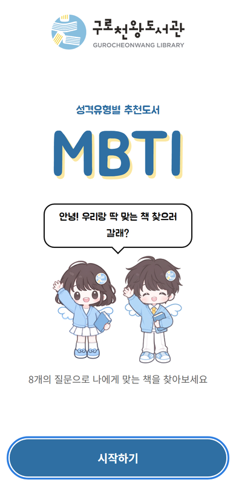
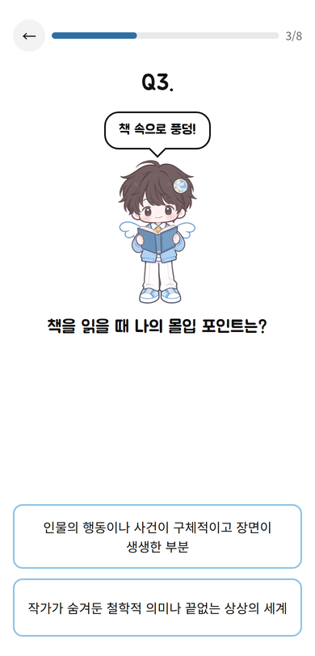
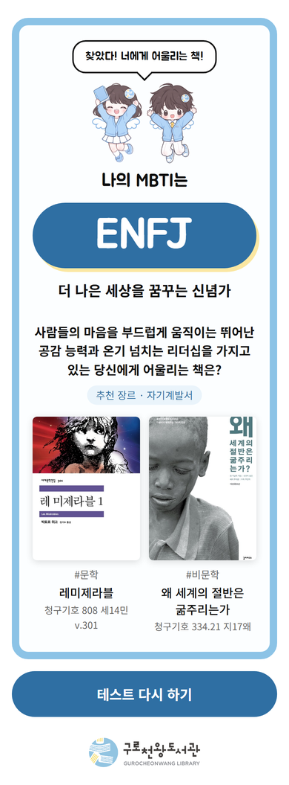
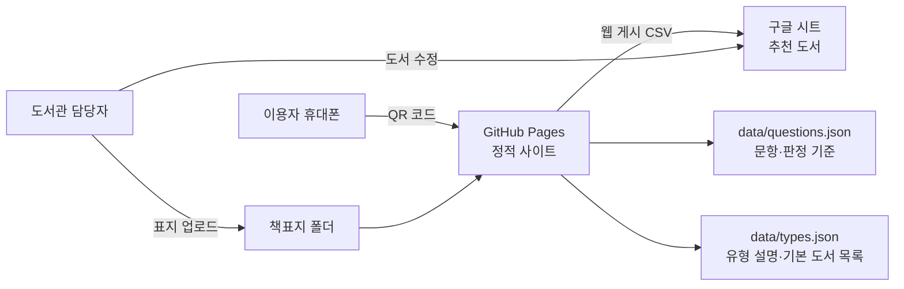

# 구로천왕도서관 MBTI 추천도서

8개의 질문으로 나의 성격유형을 알아보고, 유형에 어울리는 책을 추천받는 **구로천왕도서관 독서 취향 테스트**입니다.

**👉 사이트: https://gurocheonwang-library.github.io/bbti/**

  
  
  

## 프로젝트 개요

| 항목 | 내용 |
|---|---|
| 의뢰 | 구로천왕도서관 |
| 목적 | 이용자가 자신에게 맞는 책을 쉽게 발견하고, 도서관 대출로 이어지게 하기 |
| 대상 | 도서관 방문자 (QR 코드로 휴대폰에서 바로 참여) |
| 기간 | 2026년 11월 |
| 구성 | 8문항 · 16개 유형 · 유형별 문학/비문학 추천 도서 · 도서관 캐릭터 2종 |

## 주요 기능

- **8문항 테스트:** 문항마다 답하면 바로 다음 문항으로 넘어가고, 이전 문항으로 돌아갈 수 있습니다.
- **16개 유형 결과:** 유형 이름, 어울리는 책을 소개하는 문장, 추천 장르, 문학·비문학 추천 도서를 보여줍니다.
- **도서 정보:** 표지, 청구기호를 표시하고, 전자책 링크가 있으면 표지를 눌러 바로 읽을 수 있습니다.
- **도서관 캐릭터:** 남녀 캐릭터가 문항마다 번갈아 등장하고, 문항 상황에 맞는 표정과 말풍선을 보여줍니다.
- **구글 시트로 도서 관리:** 도서관 담당자가 개발 지식 없이 구글 시트에서 추천 도서를 바꿀 수 있습니다.
- **휴대폰 우선 화면:** 휴대폰 한 화면에 문항이 모두 들어오도록 구성했습니다.

## 구조

| 경로 | 역할 |
|---|---|
| `index.html` | 페이지 뼈대 |
| `js/app.js` | 화면 전환, 판정, 결과 표시, 구글 시트 읽기 |
| `css/style.css` | 화면 디자인 (도서관 로고 색 기준) |
| `data/questions.json` | 문항, 선택지, 지표별 판정 기준, 문항별 캐릭터·말풍선 |
| `data/types.json` | 16개 유형 이름·소개 문장·장르, 시트를 못 읽을 때 쓰는 기본 도서 목록 |
| `assets/` | 도서관 로고, 캐릭터 이미지 |
| `책표지/` | 추천 도서 표지 이미지 |
| `QR코드/` | 사이트 주소 QR 코드 (로고 PNG, 기본 PNG, 인쇄용 SVG) |
| `도서-관리-안내.md` | 도서관 담당자용 관리 안내서 |

**사용 기술:** HTML, CSS, JavaScript (프레임워크 없음), GitHub Pages, Google Sheets 웹 게시(CSV)

## 판정 방식

선택지 A는 E·S·T·J, B는 I·N·F·P에 1점씩 더합니다. 지표마다 문항 수가 홀수라 동점이 생기지 않고, 문항의 과반을 받은 쪽 글자가 결과가 됩니다.

| 지표 | 문항 | 결과 글자 |
|---|---|---|
| 외향(E) / 내향(I) | Q1 | 1점을 받은 쪽 |
| 감각(S) / 직관(N) | Q2~Q4 | 2점 이상 받은 쪽 |
| 사고(T) / 감정(F) | Q5~Q7 | 2점 이상 받은 쪽 |
| 판단(J) / 인식(P) | Q8 | 1점을 받은 쪽 |

> 이 테스트는 독서 취향을 재미있게 알아보기 위한 것으로, 공식 MBTI® 검사가 아닙니다.

## 진행하며 내린 판단

- **담당자가 직접 고칠 수 있는 구조:** 책 목록을 코드 파일에 두면 쉼표 하나만 틀려도 사이트가 멈춥니다. 그래서 도서를 구글 시트로 옮겨, 담당자가 표처럼 고치면 5분 안에 반영되게 했습니다. 드롭다운으로 유형과 구분의 오타를 막았습니다.
- **시트에 문제가 생겨도 멈추지 않게:** 형식이 틀린 행은 건너뛰고, 시트를 못 읽거나 5초 안에 응답이 없으면 기본 도서 목록으로 계속 동작합니다. 시트는 시작 화면을 띄운 뒤 뒤에서 읽어 첫 화면이 늦어지지 않게 했습니다.
- **수정 내용이 바로 보이게:** 시험 중 브라우저가 예전 문항을 계속 보여주는 문제를 발견했습니다. 데이터는 매번 최신 여부를 확인하고, CSS·JS 주소에는 버전 번호를 붙여 배포 후 바로 반영되게 했습니다.
- **문항 검토:** 원고를 사진과 대조해 오탈자를 바로잡고, 대학생 중심 표현을 공공도서관 이용자에 맞게 고쳤습니다. 답을 한쪽으로 유도하는 표현과 두 가지를 함께 묻는 선택지를 점검했습니다.
- **휴대폰에서 읽기 쉽게:** 결과의 긴 유형 설명을 화면에서 빼고 핵심 문장만 남겼습니다. 캐릭터 이미지는 배경을 지우고 크기를 줄여 빠르게 뜨도록 했습니다.
- **안전한 데이터 처리:** 시트에서 읽은 내용은 모두 글자로만 화면에 넣어, 시트에 무엇이 입력돼도 코드로 실행되지 않습니다. 전자책 링크는 `http`·`https` 주소만 허용합니다. 이용자의 답변은 어디에도 저장하거나 보내지 않습니다.
- **접근성:** 버튼은 키보드로 조작할 수 있고, 움직임 줄이기 설정을 켠 기기에서는 캐릭터 애니메이션이 멈춥니다.

## 검증

- 16개 유형이 모두 의도한 답변 조합으로 나오는지 매 수정마다 자동으로 확인했습니다.
- 지표별로 2대 1로 갈리는 답변, 이전 버튼, 휴대폰 화면(375×812)에서 가로 넘침이 없는지 확인했습니다.
- 구글 시트 연결은 책 교체, 3권 표시, 쉼표가 들어간 제목, 잘못된 행, 시트를 못 읽는 경우까지 시험했습니다.

## 역할과 도구

- **기획·협의:** 도서관과 요구사항 정리, 문항·결과 문구 검토, 추천 도서와 표지 수집, 캐릭터 기획
- **개발:** AI 코딩 도구(Claude Code)와 함께 설계·구현·검증
- **캐릭터:** 이미지 생성 도구로 장면별 표정을 만들고 배경 제거 후 배치

## 자료 이용

도서관 로고, 캐릭터, 추천 도서 정보는 구로천왕도서관의 사용 허락을 받아 사용했습니다. 책 표지 이미지의 저작권은 각 출판사에 있습니다.
